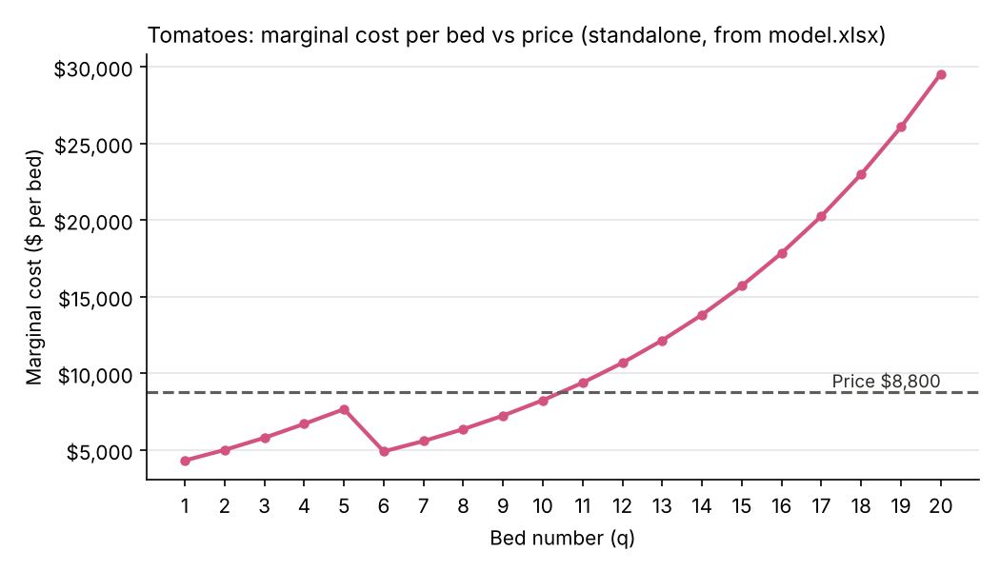
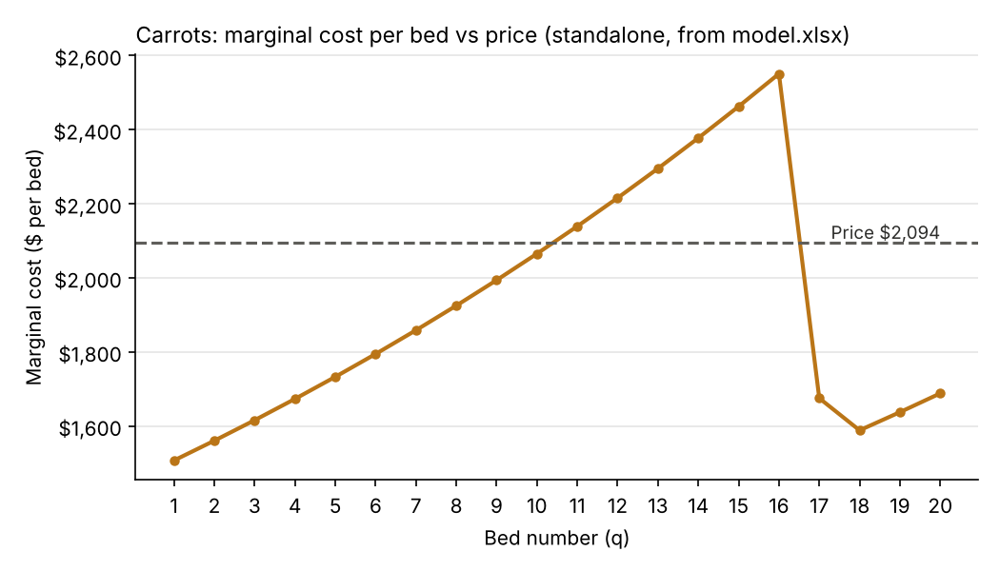
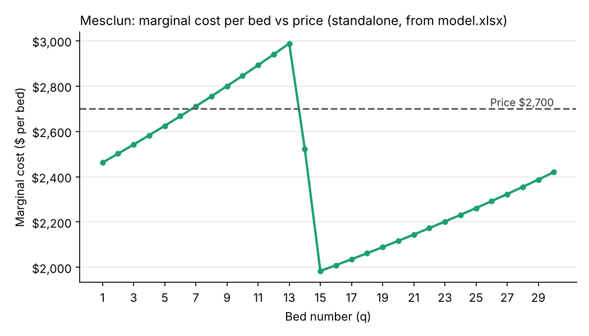

# Perfect Competition — analysis

Optimum from my model: 10 tomato, 20 carrot, 30 mesclun beds; season profit $42,775 (Summary sheet). All marginal-cost figures below come from the Marginal-cost schedules sheet of `model.xlsx`.

## 1. Where does the money crop stop, and why?

Figure 1 shows tomato marginal cost against the $8,800 price.

Tomatoes stop at 10 even though the cap of 20 has room left over (economists call this slack). The 11th bed ends up costing us 9,390 but can only bring in 8,800. This means each bed over the 10th will lose money even if the cap is at 20. The stopping point is set by economics: the market sets the price at 8,800 and we can't change that. This puts the farm in a situation where to decide on what quantity of either tomato, carrot and mesclun beds to plant.

## 2. Which constraints bind, and what would relaxing one be worth?

| Limit | Allowed | Used | Room left | Status |
|---|---|---|---|---|
| Tomato cap | 20 | 10 | 10 | slack |
| Carrot cap | 20 | 20 | 0 | binding |
| Mesclun cap | 30 | 30 | 0 | binding |
| Total beds | 64 | 60 | 4 | slack |
| Labor (720 own + 4 temps × 1,440) | 6,480 hrs | 5,277 hrs | 1,203 hrs | slack |

The limits bind that have no room would be carrot and mesclun beds with the tomato beds having room left. Total beds (4 left over) and labor (1,203 hours left) are also slack.

Figures 2 and 3 show carrots and mesclun still below price at their caps.

For carrots and mesclun the cap stops us because the last bed still costs less than its price where as the tomato bed if planted an 11th bed loses money. The 20th bed of carrots costs 1688 and earns 2094 so it makes 406, and raising `CAR_CAP` to 21 in my workbook raises season profit from $42,775 to $43,128 (+353). The 30th bed of mesclun costs 2,420 and earns 2700 so it makes 280, and raising `MES_CAP` to 31 raises it to $43,022 (+247).

I would buy and plant carrots, mesclun may earn 606 more per bed but operational costs adds 440 more in fertilizer and about an additional 270 in labor because this is required for the total of 16 hours. These costs create the drive in price advantage versus one another but still leaves carrots ahead by about 106.

Regardless of spending more money on labor or planting more gardens you'll end up adding 0 dollars to profit. You're capped on the amount of beds to plant, extra hours still won't let you plant those capped out limit beds so that would also yield 0 dollars.

## 3. Does any MC curve fall, and why?

All three curves dip in Figures 1–3: tomatoes at bed 6, carrots at bed 17, mesclun at beds 14–15.

When looking at our faced problem, in the standalone schedules (each crop planted alone), our own hours for the season are set at 720 hours at a rate of 34.72. This is reached once we are on the 5th tomato bed, after which the farm will be forced to start using temp employees at their temp rate which is half of our own hours 17.36. The marginal cost drops at bed 6 even though the physical work increases, because the cost per hour is significantly changed. Carrots dip at bed 17 and mesclun at beds 14–15 for the same reason. This shows marginal cost measures what the next bed costs in dollars, not how hard the work is.

## 4. Would each crop profit alone, and does it matter?

Source: `model.xlsx` with the bed counts set to one crop at a time (10/0/0, 0/20/0, 0/0/30); profit is the Summary's season profit, which carries the full $20,000 fixed cost. AVC = (labor cost + fertilizer cost) ÷ beds; ATC adds $20,000 ÷ beds.

| Crop alone | Best beds | Profit after full $20,000 fixed | AVC / bed | ATC / bed | Price |
|---|---|---|---|---|---|
| Tomatoes | 10 | +$6,176 | $6,182 | $8,182 | $8,800 |
| Carrots | 20 | −$16,480 | $1,918 | $2,918 | $2,094 |
| Mesclun | 30 | −$11,919 | $2,431 | $3,097 | $2,700 |

For both carrots and mesclun, the market price per bed sits above Average Variable Cost (AVC) but below Average Total Cost (ATC). Specifically, carrots sell for $2,094 per bed, which exceeds their $1,918 AVC but falls short of their $2,918 ATC. Mesclun commands $2,700 per bed, exceeding its $2,431 AVC while remaining below its $3,097 ATC.

The $20,000 fixed overhead should not influence whether you plant carrots or mesclun. Because fixed costs must be paid regardless of planting decisions, they are irrelevant to short-run operational choices. Since both crops command a price higher than their AVC, every planted bed generates a positive contribution margin $176 per bed of carrots and $269 per bed of mesclun. Planting 20 beds of carrots and 30 beds of mesclun generates $11,590 in gross margin to help pay down that fixed overhead, leaving the farm in a much better overall financial position than leaving the beds unplanted.

Comparing price versus AVC settles whether a crop is worth planting in the short run. As long as price exceeds AVC, the crop covers its direct growing expenses and contributes cash toward fixed costs. Comparing price versus Marginal Cost (MC) dictates how many beds to plant to maximize profit once production starts, while comparing price versus ATC evaluates long-run economic viability rather than immediate operational decisions.

## Sensitivity

| If this happens… | Best plan | Season profit |
|---|---|---|
| Nothing (base) | 10 / 20 / 30 | $42,775 |
| Tomato price −20% | 8 / 20 / 30 | $26,587 |
| Carrot price −20% | 10 / 19 / 30 | $34,412 |
| Mesclun price −20% | 10 / 20 / 21 | $27,780 |
| Carrot cap +4 | 10 / 24 / 30 | $43,854 |
| Mesclun cap +4 | 10 / 20 / 34 | $43,555 |
| Only 3 temps | 9 / 20 / 30 | $42,223 |

Source: best mixes found by Claude re-running my model's formulas across every allowed mix. The mesclun row was checked in `model.xlsx`: at a $2,160 mesclun price, 10/20/21 earns $27,780 vs $26,575 for 10/20/30.

## Compared with my Stage 1 hypothesis

My original prediction had 15/20/25 was my before model guess which quickly changed to 10/20/30. The thought process originally was the labor penalties were gonna add up quickly and made the empty 4 beds make the most sense without higher level analysis. What was underestimated was how quickly those labor costs were going to climb after we hit anything past our 10th tomato bed. I also thought with mesclun what really caused us to stop was marginal costs, but it is actually the cap set by the scenario. The empty 4 beds ultimately do not provide any input or value which ultimately costs you more if you decide to do anything with more tomato beds. What was not seen at all was the marginal cost dips at 720 hours. This being said once we hit the 720 hours we then revert to using temp hires at half the price, which makes the next bed cheaper for a moment, but marginal cost keeps climbing after that because each new bed needs more hours than the last.
